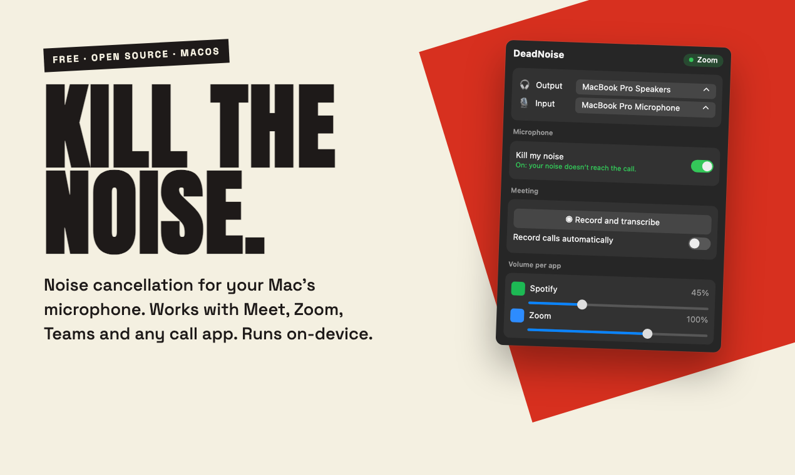
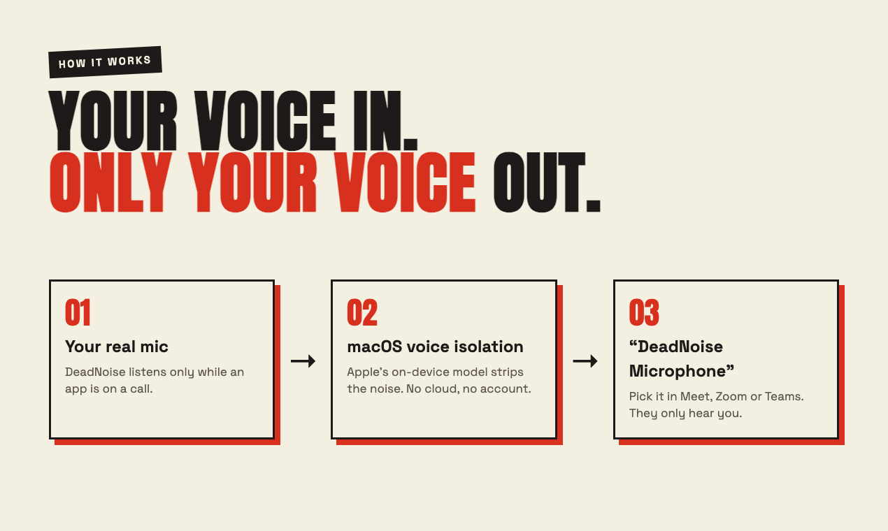

# DeadNoise

**English** · [Português](README.pt-BR.md)

[](https://github.com/wellmota/deadnoise/releases/latest)
[](#requirements)
[](#install)
[](LICENSE)

**Free, open-source noise cancellation for your Mac's microphone.** Works with Meet, Zoom, Teams and any call app.
Runs on your Mac: no account, no subscription, no cloud.

[**Download for Mac**](https://github.com/wellmota/deadnoise/releases/latest/download/DeadNoise.dmg) · [Website](https://deadnoise.vercel.app/en/)



## Features

- **Kill my noise.** Keyboard, fan, dog: gone before your voice leaves your Mac. DeadNoise uses Apple's on-device
  voice isolation and delivers the result on a virtual microphone, **DeadNoise Microphone**. Pick it in your call app.
- **Volume per app.** Turn the music down without turning the meeting down. Every app gets its own slider, from 0 to 150%.
- **Volume per tab** in Chrome, Edge, Brave, Arc and Vivaldi, with the bundled browser extension.
- **Record & transcribe meetings.** Your mic ("Me") and the Mac's audio ("Others") on separate tracks, transcribed
  on your Mac (macOS 26). Can start automatically when a call app opens the microphone.
- **Call detection and mic mute** right in the menu bar, with a warning when you're muted during a call.
- **Signed automatic updates.**

## How it works



DeadNoise only listens to your real mic while some app is using "DeadNoise Microphone", and adds about 0.1 s of delay.
Per-app volume uses Core Audio process taps: an app at 100% is left untouched.

## Install

Both downloads are signed with Developer ID and notarized by Apple:

- [**DeadNoise.dmg**](https://github.com/wellmota/deadnoise/releases/latest/download/DeadNoise.dmg): open it, drag the
  app to Applications, then in the app's menu turn on "Kill my noise" > "Install virtual microphone" (asks for your password).
- [**DeadNoise.pkg**](https://github.com/wellmota/deadnoise/releases/latest/download/DeadNoise.pkg): macOS installer that
  puts both the app and the virtual microphone in place.

Your Mac's audio restarts for a few seconds when the virtual microphone is installed.
Then, in Meet, Zoom or Teams, choose **DeadNoise Microphone** as the microphone.

### Requirements

macOS 15 or later, Apple Silicon or Intel. Meeting transcription requires macOS 26.
The app is in English and Portuguese and follows your Mac's language.

## Build from source

```bash
git clone https://github.com/wellmota/deadnoise && cd deadnoise
./build.sh install           # builds the app, installs it in /Applications and opens it
./Driver/build.sh install    # virtual microphone (asks for your password, restarts audio)
```

You can also open `Package.swift` in Xcode. To remove everything: `./uninstall.sh`.

## Limitations

- It cleans **your** microphone, not the other participants' audio.
- If an app is set to "DeadNoise Microphone" while DeadNoise is closed, that app gets silence.
- Recording captures all of the Mac's audio, not just the call app.
- Without headphones, your mic also picks up the other people's voices.

Recording calls may require the participants' consent, depending on where you live.

## Contributing

Bug reports and pull requests are welcome. Open an [issue](https://github.com/wellmota/deadnoise/issues) with your
macOS version, your microphone/headphones and the call app you use. Most of the code comments and the
[developer docs](README.pt-BR.md) (architecture, release process) are in Portuguese.

## License

[MIT](LICENSE)
